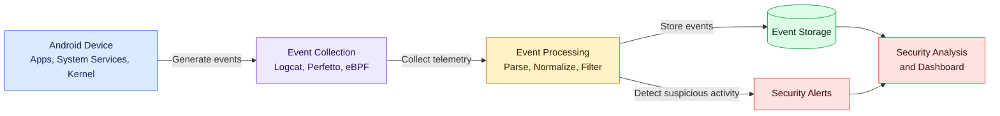

<div align="center">
    <p align="center">
        <a href="https://developer.android.com/">
          
        </a>
    </p>



# **`AET`** | Event Tracing for Android
</div>

> AET is a tracing facility that allows a user to log events to a file (JSON, XML, CSV)

[]()
[]()
[]()

<p align="center">
    <a href="https://github.com/cybersecurity-dev/"></a>
    &nbsp;
    <a href="https://www.youtube.com/@CyberThreatDefence"></a>
    &nbsp;
    <a href="https://cyberthreatdefence.com/my_awesome_lists"></a>
    
</p>

## 📖 Contents
- [My Awesome Lists](#my-awesome-lists)
- [Contributing](#contributing)
- [Contributors](#contributors)

<details>

<summary>Install required tools on Linux</summary>

### For Ubuntu 18.04, 20.04, 22.04

```bash
sudo apt-get update
```
</details>


<details>

<summary>Install required tools on Windows</summary>

### For Windows 11

```powershell
```
</details>


<details>

<summary>Install required python libs</summary>

### pip install
```script
pip install -r requirements.txt
python3 setup.py install
```

### conda install
```script
conda config --add channels conda-forge
conda install --file requirements_conda.txt
python3 setup.py install
```

</details>


## Common Android Kernel Event Types

| **Event Type**         | **Description**                                                              | **Subsystem / Use Case**               |
|------------------------|-------------------------------------------------------------------------------|----------------------------------------|
| `EV_KEY`               | Key/button pressed or released                                               | Input subsystem (`/dev/input`)         |
| `EV_REL`               | Relative axis movement (e.g., mouse movement, joystick)                      | Input subsystem                         |
| `EV_ABS`               | Absolute axis value change (e.g., touchscreen, accelerometer)                | Input subsystem                         |
| `EV_SYN`               | Synchronization event (marks end of a set of input events)                   | Input subsystem                         |
| `EV_MSC`               | Miscellaneous input events                                                    | Input subsystem                         |
| `EV_SW`                | Switch state changes (e.g., lid open/closed, headset inserted)               | Input subsystem                         |
| `EV_LED`               | LED status changes (caps lock, etc.)                                         | Input subsystem                         |
| `EV_SND`               | Sound output events (beep, bell)                                              | Input subsystem                         |
| `uevent`               | Kernel-generated device state change notification                            | Device manager (e.g., hotplug)          |
| `binder_transaction`   | IPC transaction event                                                        | Binder (Android IPC mechanism)          |
| `binder_transaction_fd`| IPC transaction with file descriptor                                         | Binder                                  |
| `binder_reply`         | Reply to a binder transaction                                                | Binder                                  |
| `binder_dead_binder`   | Notification that a binder node is no longer active                          | Binder                                  |
| `trace_sched_switch`   | Task context switch (scheduling trace event)                                 | Kernel tracing (ftrace)                 |
| `trace_sys_enter`      | System call entry                                                            | Tracing/debugging                       |
| `trace_sys_exit`       | System call exit                                                             | Tracing/debugging                       |
| `kprobe_event`         | Dynamic tracing via kernel probes                                            | Debugging/performance analysis          |
| `pm_wakeup`            | Power manager wakeup event                                                   | Power management                        |
| `thermal_event`        | Temperature threshold triggered (e.g., CPU/GPU thermal state)                | Thermal management                      |
| `battery_status_change`| Battery state change (e.g., charging/discharging)                            | Power subsystem                         |
| `ion_heap_shrink`      | Memory allocator (ION) event for memory shrink                               | Memory allocator (Android-specific)     |
| `vibrator_on/off`      | Vibration motor activation/deactivation                                      | Input/haptic feedback                   |

### My Awesome Lists
You can access the my awesome lists [here](https://cyberthreatdefence.com/my_awesome_lists)

### Contributing

[Contributions of any kind welcome, just follow the guidelines](contributing.md)!

### Contributors

[Thanks goes to these contributors](https://github.com/cybersecurity-dev/aet/graphs/contributors)!

[🔼 Back to top](#aet--event-tracing-for-android)
